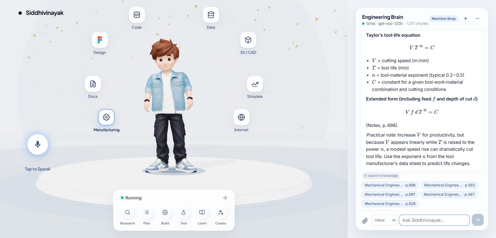

# Siddhivinayak — a 3D engineering AI twin

A talking 3D character backed by a **self-learning engineering brain**. It reads your notes (PDF, DOCX, PPTX, TXT, MD), answers systematically with page citations, runs real engineering calculators, remembers what you teach it, and changes its 3D world to match the topic.



## What it does

| Area | Details |
|---|---|
| **Learns anything** | Drop a file into `server/knowledge/<module>/` or the 📎 button in the chat. Files are chunked by heading/page, embedded locally on CPU, and searchable within seconds. A watcher picks up new or changed files automatically. |
| **Hybrid search** | Dense vectors (`BAAI/bge-small-en-v1.5` via fastembed/ONNX) + BM25 keyword search, fused with reciprocal-rank fusion — so both "why does a pipe flow go turbulent" and "E7018" find the right page. |
| **Agent** | LangGraph agent (LangChain `create_agent`) with tools, SQLite-persisted conversation memory and a `remember` tool for permanent learned facts. |
| **Engineering modules** | `screws` — ISO metric thread geometry (computed from the ISO 68-1 profile), ISO 898-1 property classes, VDI 2230 tightening torque, bolted-joint check.  `welding` — ISO 4063 processes, AWS A5.1 electrode decoder, EN 1011-1 heat input, IIW CE / Pcm, fillet-weld sizing. The LLM decides *when* to call them; Python does the maths. |
| **Original pages** | Every citation chip opens the actual PDF page as an image, so garbled extracted formulas can be checked against the source. |
| **Voice** | Speech-to-text in Chrome/Edge (tap the mic), Indian-English neural TTS (Edge `en-IN-PrabhatNeural`, Piper fallback), jaw/head motion driven by audio volume. |
| **Scenes** | Each answer carries a scene id — *Welding Bay* (sparks + arc flicker), *Fastener Lab*, *Fluid Lab* (bubbles), *Thermal Lab* (heat shimmer), *Machine Shop* (chips), *Design Studio* (blueprint grid). Preview with `?scene=welding`. |
| **Any LLM** | Groq, Claude, Gemini or fully-offline Ollama — set in `server/.env`. With no key at all it still answers by retrieval. |

## Architecture

```
Browser (React Three Fiber, :5173)
  │  /api/*  ─────────────▶  brain_server.py (:5060)
  │                            ├─ LangGraph agent ── LLM (Groq / Claude / Gemini / Ollama)
  │                            │     └─ tools: search_knowledge, remember, thread_data, bolt_torque,
  │                            │              bolted_joint_check, electrode_decode, weld_heat_input, …
  │                            ├─ KnowledgeBase: fastembed vectors + BM25, incremental index
  │                            └─ watcher: server/knowledge/** + assets/notes/
  │  /tts/*  ─────────────▶  tts_server.py (:5050)  Edge neural TTS / Piper
```

```
server/
  brain/
    config.py        settings from .env
    loaders.py       PDF/DOCX/PPTX/TXT/MD → heading-aware chunks with page numbers
    store.py         hybrid vector + BM25 index (incremental, persisted in server/data/)
    tools.py         LangChain tools exposed to the agent
    agent.py         LangGraph agent, prompt, history compaction for small-quota providers
    scenes.py        topic → 3D scene id
    engineering/
      fasteners.py   ISO threads, ISO 898-1, VDI 2230, joint check
      welding.py     ISO 4063, AWS A5.1, EN 1011-1, CE/Pcm, fillet welds
  knowledge/
    screws/          fasteners_reference.md  (+ your files)
    welding/         welding_reference.md    (+ your files)
    memory/          facts the agent was taught (local only)
    inbox/           uploads without a module (local only)
  brain_server.py    Flask API
  tts_server.py      voice
src/
  hooks/useBrain.js  chat / learn / health
  hooks/useListen.js browser speech recognition
  scenes.js          scene presets
  components/environment/SceneDirector.jsx   lighting, background and particle transitions
  components/ui/ChatPanel.jsx                chat, uploads, KaTeX formulas, page viewer
```

## Run it (Windows)

```bat
copy server\.env.example server\.env   &  rem then put your API key in it
start.bat
```

`start.bat` creates the Python venv and installs everything on first run, then opens three windows (brain, voice, site) and the browser at http://localhost:5173.

Manual equivalent:

```bat
python -m venv venv
venv\Scripts\pip install -r server\requirements.txt
npm install
cd server && ..\venv\Scripts\python brain_server.py      & rem :5060
cd server && ..\venv\Scripts\python tts_server.py        & rem :5050
npx vite                                                 & rem :5173
```

First start downloads the 67 MB embedding model. Indexing a 900-page PDF takes about 5 minutes on a laptop CPU; after that only new or changed files are processed.

**Not in the repo (kept local):** your notes PDFs (`assets/notes/`), `server/.env`, learned memory, the generated index, and the Piper `.onnx` voice models (download from [rhasspy/piper voices](https://huggingface.co/rhasspy/piper-voices) if you want the offline fallback voice).

## Choosing an LLM

| Provider | Cost | Notes |
|---|---|---|
| Groq `openai/gpt-oss-120b` | free tier | Very fast per call, but the free plan allows **8k tokens/minute** — about one agent answer per minute. Back-to-back questions wait for the quota to reset. |
| Gemini `gemini-2.5-flash` | free tier | Much larger per-minute quota; a good free daily driver. |
| Claude `claude-opus-5-5` | paid | Best reasoning and tool use, 1M-token context. |
| Ollama `llama3.1:8b` | free, offline | Runs on CPU with 16 GB RAM, slowly. |

## Teaching it

- **Files:** drop into a module folder, or upload in the chat and pick the module.
- **Facts:** just say it — *"remember: our gearbox mounts use M16 10.9 at 250 N·m"* — it is stored in `memory` and searchable forever.
- **New module:** create a folder `server/knowledge/<name>/` (e.g. `gd&t`, `casting`, `cnc`) and put files in it.

## Roadmap ideas

- Extra Mixamo animations (talking, thinking, pointing) loaded from `public/character/anims/`
- Standards data packs as CSV (ISO 4762 SHCS dimensions, ISO 2553 symbols) loaded into new tools
- Image/diagram understanding of PDF figures with a vision model
- GATE-style quiz mode with spaced repetition over your notes
